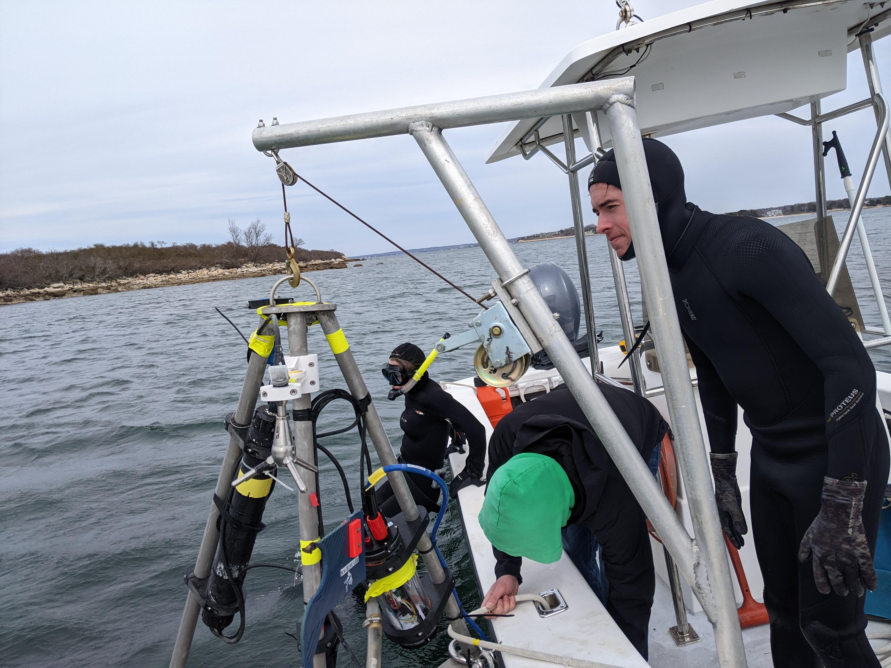
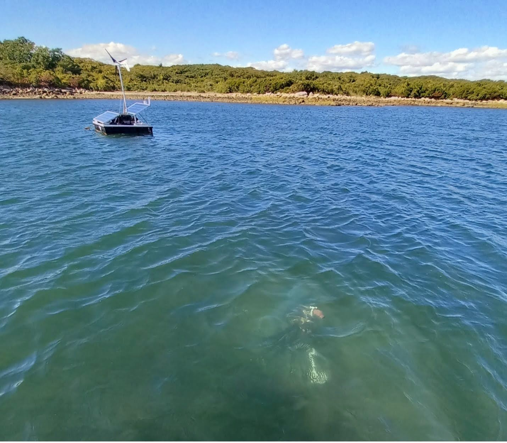
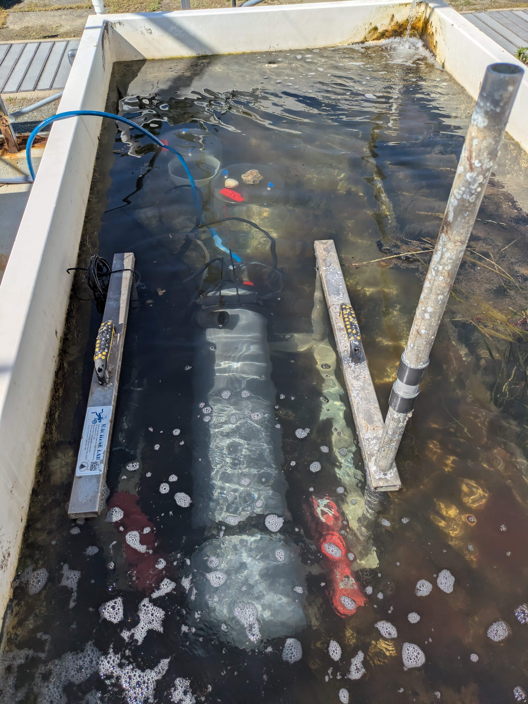
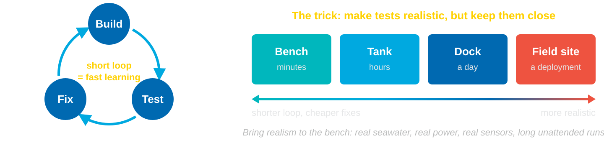
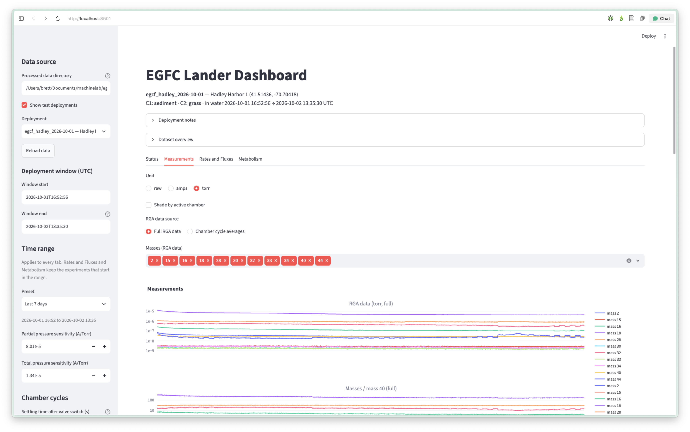
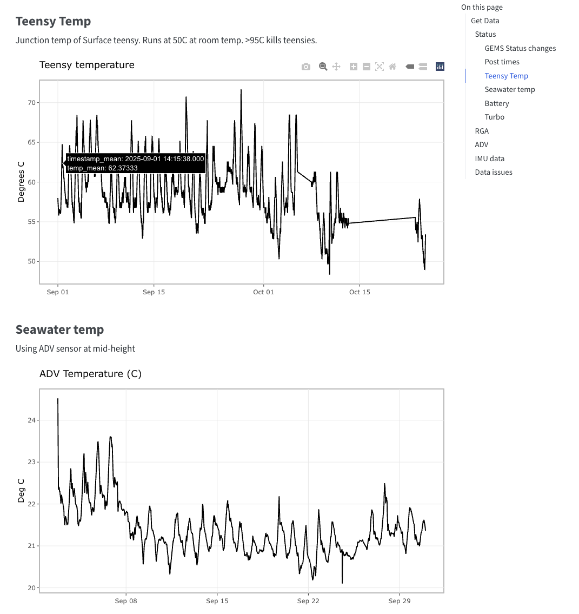
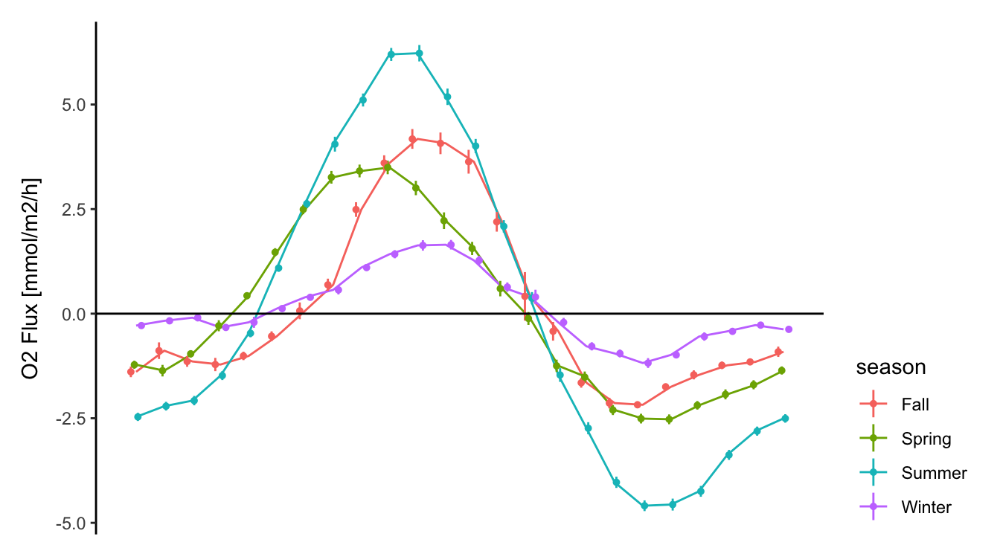
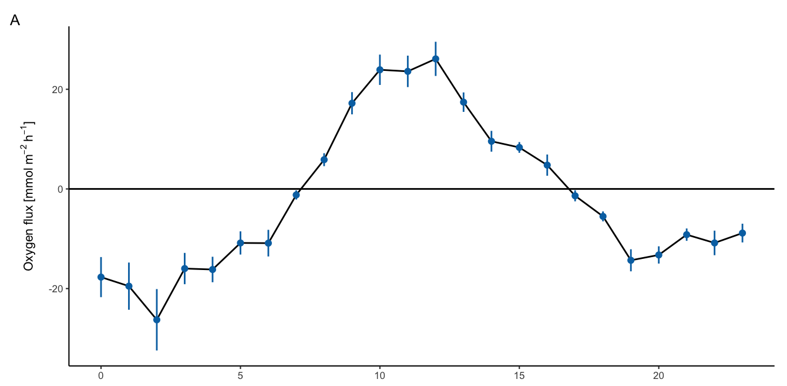
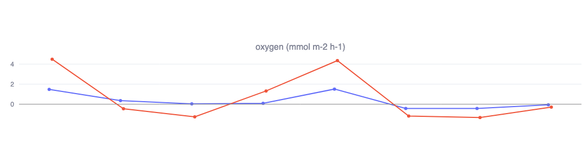

---
# Alternate titles (pick one):
#   - The Ocean Finds Your Bugs: Lessons from Three Benthic Flux Systems
#   - Three Flux Systems, Many Lessons: Building Better Seafloor Instruments
#   - What LECS, GEMS, and EGCF Taught Me About Building Instruments
#   - Test on Land, Analyze Early, Phone Home: Notes from Benthic Flux Engineering
#   - Lessons from the Seafloor: Making Flux Systems That Work the First Time (Eventually)
title: "Three Flux Systems, Many Lessons"
subtitle: "Building better seafloor instruments"
author: "Brett Longworth · MACHINELab"
date: today
date-format: long
output-file: index.html
format:
  revealjs:
    theme: [default, whoi.scss]
    width: 1600
    height: 900
    logo: assets/whoi-logo-white.png
    slide-number: c/t
    show-slide-number: speaker
    transition: none
    hash: true
title-slide-attributes:
  data-background-image: assets/whoi-title-bg.jpg
  data-background-size: cover
  data-background-opacity: "0.35"
---

## Three systems, three ways to measure flux {background-image="assets/whoi-bg.jpg"}

:::: {.columns}

::: {.column width="32%" .system}
{fig-alt="Photo of the LECS eddy covariance lander deployed on the seafloor"}

### LECS
*Long-term Eddy Covariance System*

Correlates vertical velocity with concentration fluctuations

$$F = \overline{w'C'}$$

[O₂ · H⁺ (pH) · heat]{.gases}
:::

::: {.column width="2%"}
:::

::: {.column width="32%" .system}
{fig-alt="Photo of the GEMS gradient sampling system deployed in an eelgrass meadow"}

### GEMS
*Gradient Exchange Mass Spectrometry*

Membrane inlet mass spec measures concentration at two heights; gradient × mixing gives flux

$$F = -K_z\,\frac{\partial C}{\partial z}$$

[O₂ · CO₂]{.gases} [CH₄ · H₂S too small to resolve in the open meadow]{.miss}
:::

::: {.column width="2%"}
:::

::: {.column width="32%" .system}
{fig-alt="Photo of the EGCF benthic chamber enclosing eelgrass in a test tank"}

### EGCF
*Eel Grass Chamber Flux*

Change in concentration inside a closed chambers over time

$$F = \frac{V}{A}\,\frac{dC}{dt}$$

[O₂ · CO₂ · N₂ · CH₄ · H₂S]{.gases} + **SCALUP** sonde: T, P, S, O₂, pH
:::

::::

::: {.callout-box}
**Reuse your tools:** EGCF uses similar surface power/data system to LECS and GEMS, runs on the GEMS mass spec with improved software, and adds SCALUP, a sonde built in our lab.
:::

::: notes
**[Title slide, 0:00–0:15]** Hi, I'm Brett, a research associate in MACHINELab. Over the last few years I've worked on three different systems for measuring benthic flux. Today isn't about the fluxes. It's about what building them taught me about building instruments.

**[0:15–1:00]** Three systems that use different physics.

- **LECS** is eddy covariance. It measures vertical water velocity and O₂, temperature, and pH many times a second, and the covariance of the two gives the flux of O₂, heat, and H⁺, with no disturbance to the seafloor. *F = mean of w′C′*: the average product of the velocity and concentration fluctuations.
- **GEMS** is a gradient method. A quadrupole mass spectrometer samples water from several heights above the bottom, and the concentration gradient times turbulent mixing gives the flux. *F = −K ∂C/∂z*, where K is the eddy diffusivity, which we estimate from the turbulence. We hoped to get O₂, CO₂, CH₄, and H₂S. In an open eelgrass meadow, CH₄ and H₂S were too dilute to resolve.
- **EGCF** is the simplest idea: put a chamber over the eelgrass and watch concentrations change. *F = (V/A) dC/dt*: the rate of change, scaled by chamber volume over footprint area. That gives back the signal that's too small in open water.

EGCF reuses the GEMS mass spec and software, and adds SCALUP, a sonde we built in-house for T, P, S, O₂, and pH. Lesson zero: build hardware, firmware, and analysis code in modules that can outlive the project they were built for.

All three had the same kinds of engineering problems, and that's the rest of this talk.
:::

## Lesson 1: The ocean is a [great tester]{.accent}, and a bad place to test {background-image="assets/whoi-bg.jpg"}

- The ocean finds every leak, power issue, and firmware bug
- Problems at sea cost a boat day, a swim, or the experiment
- Find problems when the fix is cheap. Iteration is quick on a bench!
- **Version firmware**: know what was deployed when
- **Document tests**: build, setup, result

{.cycle-fig fig-alt="Diagram of a build, test, fix loop labeled: short loop equals fast learning. Next to it, four test venues in order: bench (minutes), tank (hours), dock (a day), and field site (a deployment). An arrow runs from shorter loop and cheaper fixes toward more realistic. Caption: the trick is to make tests realistic but keep them close, bringing realism to the bench with real seawater, power, sensors, and long unattended runs."}

::: notes
**[1:00–1:40]** The ocean is a fantastic test environment. It's corrosive, cold, wet, moving, and full of life, and it finds every weakness in your system within days. That's exactly why it shouldn't be your first test.

Development is a build, test, fix loop, and how fast you improve depends on how short that loop is. On the bench, a loop takes minutes. In a tank, hours. On the dock, a day. At the field site, a whole deployment. The trick is to make tests as realistic as possible while keeping them close, so the loop stays short. Bring the realism to the bench: real seawater, real power supplies, real sensors, and long unattended runs. Save the field site for the problems you can only find there.

You'll change firmware constantly while going around that loop: a fix after the bench test, a new sample rate after the tank. Tag every build in git and have the firmware write its version or commit hash into every data file header. Then a test result is never "the system did X", it's "build 1.4.2 did X", and you know whether a fix worked.

Document every test, even the boring ones. A short log entry (date, firmware build, setup, what you were testing, what happened, and what you changed) takes two minutes. Without it, three tests later nobody remembers whether the pump fix was in the tank run or the dock run. Notes plus versioned firmware let you connect a symptom to a cause, and they're what you hand to the next person who builds one of these.

*[Add a specific example: e.g. a connector or housing failure that a tank test would have caught.]*
:::

## Lesson 2: Build the analysis [before]{.accent} you deploy {background-image="assets/whoi-bg.jpg"}

:::: {.columns}

::: {.column width="45%"}
- **Reduce → analyze → plot** is a diagnostic tool for system function from the test period onward
- Check the data's *structure*, not just values:
  - gaps
  - out-of-range or stuck values
  - clock drift, timing jitter
  - true vs. nominal sample rate
- **Reproducible processing**: version the code, pair it with the firmware version
:::

::: {.column width="55%"}
{fig-alt="Screenshot of the EGCF webapp"}
:::

::::

::: notes
**[1:40–2:30]** This is the lesson I most wish I'd learned sooner. If you wait until after the science deployment to write the analysis, you find out too late that the data can't answer your question.

When the pipeline exists during testing, every test deployment produces a flux estimate and plots. Problems with the system show up right away: a noisy sensor, a pump that isn't flushing, a clock that drifts.

Look at the data's structure as well as its values. Plot the time between samples. Are you actually getting 8 Hz, or 7.6 with gaps? Count the missing records. Check ranges and stuck values. For eddy covariance, a small timing offset between sensors biases the flux, so timing *is* data.

The other half of the versioning story is the processing code. Firmware versions tell you how the data was *collected*. Versioned, reproducible processing tells you how it was *turned into fluxes*. Keep the pipeline in git, record the code version alongside every output, and make it rerunnable from raw data. Then when you fix a bug months later, you can reprocess everything and know exactly which results changed. Firmware version plus processing version answers "what was running when?" Without both, you're guessing why the data changed partway through a deployment.

*[Describe what the plot shows: e.g. the Δt histogram from LECS that revealed dropped samples.]*
:::

## Lesson 3: [Remote monitoring]{.accent} saves time and stress {background-image="assets/whoi-bg.jpg"}

:::: {.columns}

::: {.column width="45%"}
- Find issues on **day 2**, not at recovery on **day 60**
- Even partial data helps:
  - battery voltage
  - sample counts / last good timestamp
  - a few key sensor values
- Lets you intervene, adjust, or recover early
:::

::: {.column width="55%"}
{fig-alt="GEMS status report from a two-month deployment: time series of surface Teensy microcontroller temperature, ranging 50 to 70 degrees C with data gaps in October, and ADV seawater temperature, ranging 20 to 24 degrees C" style="max-height: 680px; width: auto; border-radius: 8px; display: block; margin: 0 auto;"}
:::

::::

::: notes
**[2:30–3:10]** For short deployments you can get away without it, but for anything that runs weeks to months, remote monitoring (the system sending status back to shore while it's deployed) changes everything. Without it, a failure on day 2 means 58 days of nothing, and you don't learn that until recovery.

It doesn't have to be fancy. A few bytes an hour (battery, how many samples were recorded, the last good timestamp, a couple of sensor values) is enough to know whether the system is healthy. With that, you can schedule a dive, change a setting, or pull the system before you lose the season.

*[Add example: what LECS remote monitoring caught, or what we missed without it.]*
:::

## Takeaways {background-image="assets/whoi-bg.jpg"}

1. **Test on land first**: quick iterations save time later
2. **Analyze early**: check data structure; know you're getting good data
3. **Check in remotely**: catch problems early
4. **Reuse tools**: build modules that outlive one project
5. **Ask around**: WHOI has solved these problems before. Ask people, not just machines

:::: {.columns}
::: {.column width="32%"}
{.result-plot fig-alt="LECS mean diel cycle of benthic oxygen flux by season, from about -5 to +6 mmol per square meter per hour, largest in summer and smallest in winter"}

::: {.funder}
<!-- Shell logo: English Wikipedia, File:Shell_logo.svg (non-free trademark, used under fair use)
     https://en.wikipedia.org/wiki/File:Shell_logo.svg -->
{.funder-logo fig-alt="Shell logo"}

[**LECS** funded by Shell Research]{.funder-text}
:::
:::
::: {.column width="2%"}
:::
::: {.column width="32%"}
{.result-plot fig-alt="GEMS mean diel cycle of oxygen flux by hour of day with error bars, from about -26 to +26 mmol per square meter per hour, positive during daylight"}

::: {.funder}
<!-- NSF logo: Wikimedia Commons, File:NSF_logo.svg (public domain, US government work)
     https://commons.wikimedia.org/wiki/File:NSF_logo.svg -->
{.funder-logo fig-alt="NSF logo"}

[**GEMS** funded by NSF OCE-OTIC]{.funder-text}
:::
:::
::: {.column width="2%"}
:::
::: {.column width="32%"}
{.result-plot fig-alt="EGCF oxygen flux from two chambers over successive incubations, from about -1 to +4.5 mmol per square meter per hour"}

::: {.funder}
<!-- MassDEP logo: Wikimedia Commons, File:MassDEP_logo.svg (listed as public domain)
     https://commons.wikimedia.org/wiki/File:MassDEP_logo.svg -->
{.funder-logo fig-alt="MassDEP logo"}

[**EGCF** funded by MA DEP]{.funder-text}
:::
:::
::::

[Thanks! · blongworth@whoi.edu]{.subtle}

::: notes
**[3:10–4:00]** To sum up: test on land first, build the analysis early, look at the data's structure, and version your code, monitor long deployments remotely, and design things to be reused. Here's a representative result from each system. They all work now, thanks to those lessons.

None of this is new. WHOI has built seafloor instruments, benthic landers, and long-term moorings for decades, and other groups here learned these lessons the hard way long before I did. So the real takeaway: before your first deployment, go ask them. Someone down the hall has probably already solved your problem. And in the age of AI, it's tempting to just ask a chatbot. Those tools are useful, but they haven't lost an instrument to biofouling or a flooded connector. Ask people, not just machines. Thanks!
:::
